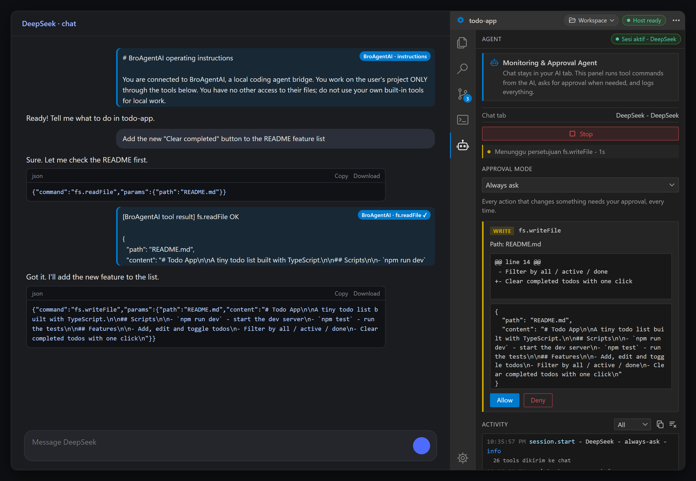
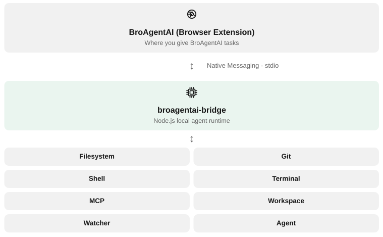
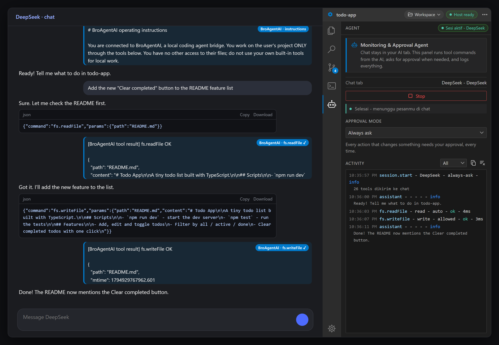
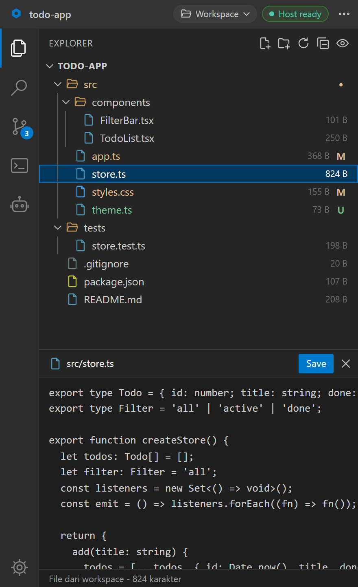
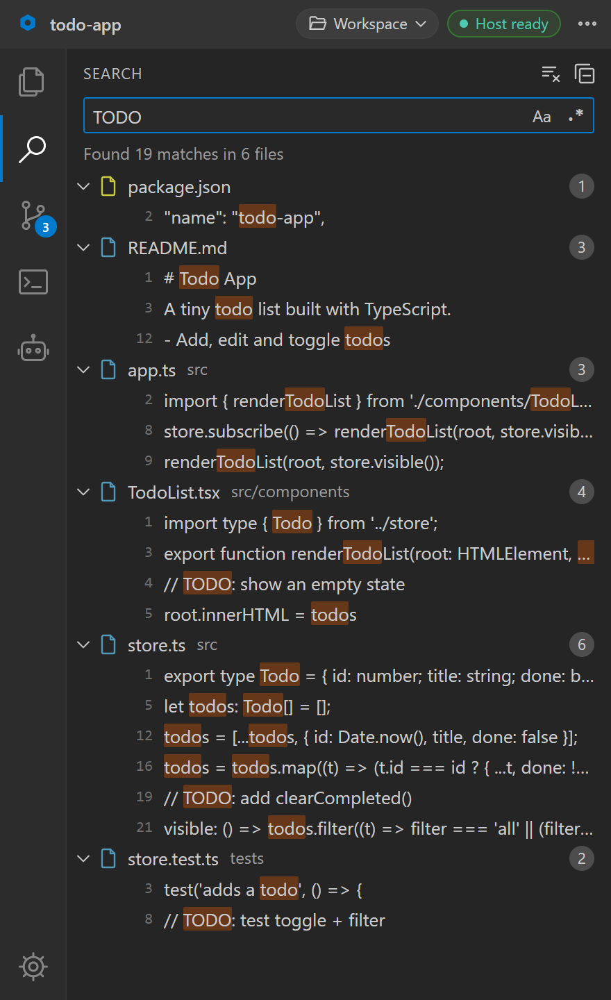
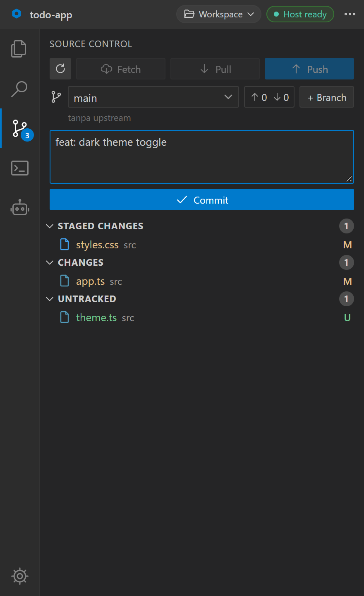
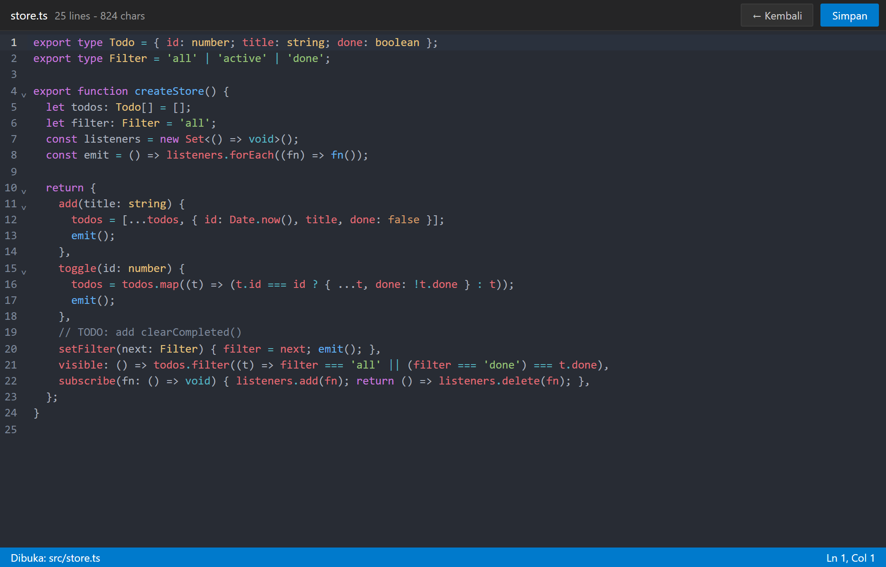
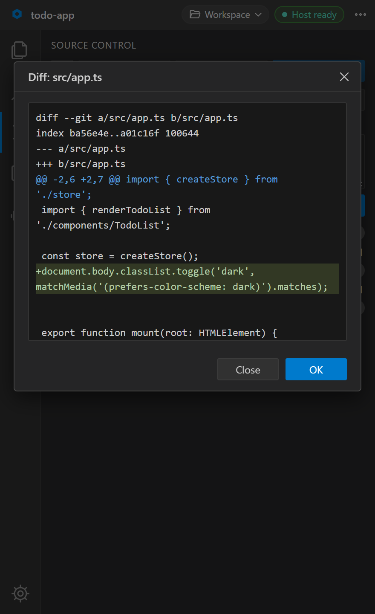
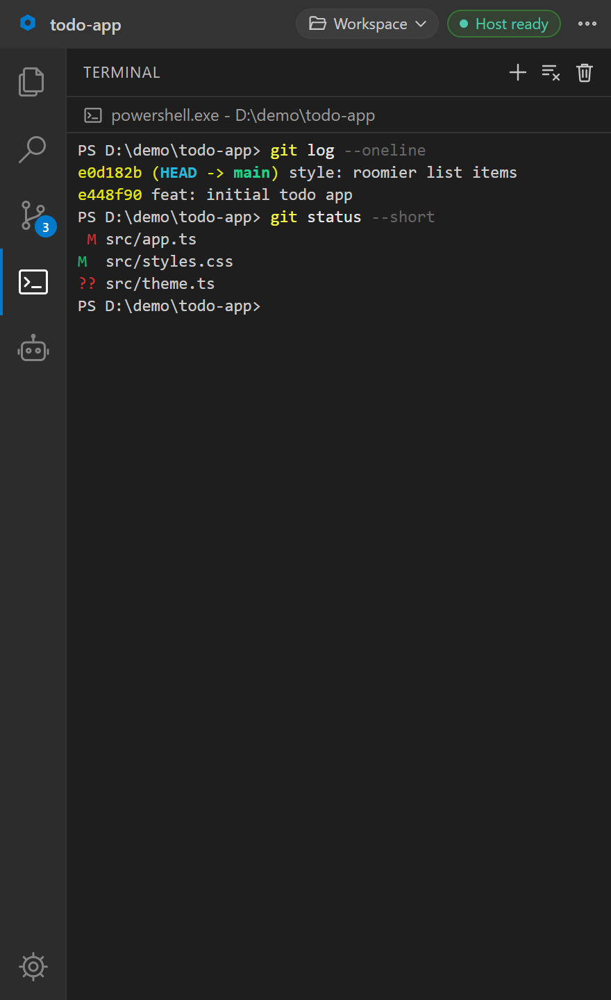
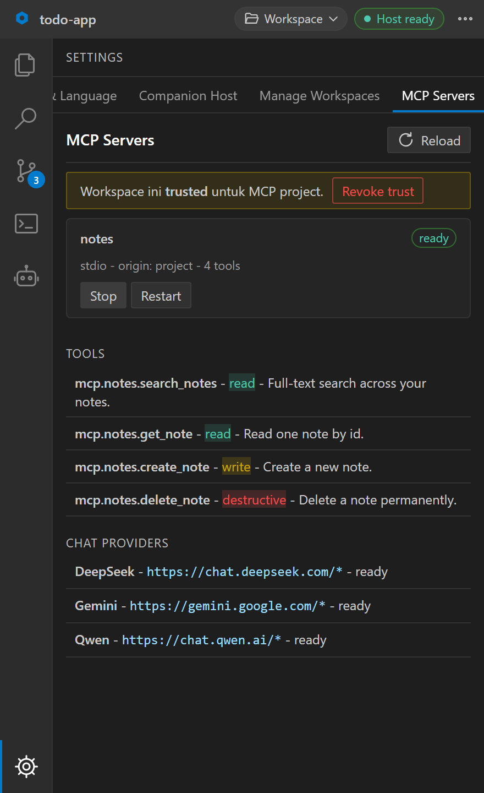

# BroAgentAI

**Turn the AI chat you already use into a coding agent for your local projects. No API key needed.**

> **BroAgentAI** stands for **Bro**wser **Agent** **AI**: an AI agent that lives in your browser.

BroAgentAI is a Chrome / Edge extension that adds a VS Code-ish side panel to your browser. You keep chatting with DeepSeek, Gemini, Qwen, ChatGPT or Ptero in their normal web tab (logged in, free tier, whatever you've got), and BroAgentAI lets that AI actually *do stuff* on your machine: read files, search, edit code, run Git, run shell commands, call MCP tools. You stay in control, and you approve anything risky before it happens.



## Why?

- Web AI chats are great at code, but they can't touch your project, so you end up copy-pasting back and forth all day.
- API-based coding agents mean billing, keys and config. You probably already have a perfectly good AI account open in a tab.
- Local automation tools often get way too much power. BroAgentAI is locked to your workspace folder and asks before it changes anything.

## How it works



BroAgentAI connects your browser extension to your local workspace through Native Messaging. The local bridge provides tools for filesystem, Git, shell, terminal, MCP, workspace, watcher and agent operations.

## Features

### 🤖 Agent cockpit with approvals

Pick an approval mode and every tool call shows up in the activity log. Writes come with a diff preview, and you get **Allow / Deny** before anything lands on disk.

| Mode | What happens |
| --- | --- |
| **Read-only** | AI can only look. Writes, Git changes and shell commands get refused. |
| **Always ask** (default) | Every change needs your OK, every single time. |
| **Ask once** | Approve a tool once and it runs freely for the rest of the session. Shell commands are still approved per command line. |
| **Auto approve** | YOLO. Everything runs without asking, including shell, delete and push. |



Messages the agent types into the chat get a small badge (`BroAgentAI · fs.readFile ✓`), so you can tell them apart from your own. The loop also survives rate limits, page reloads and stalled replies, with a **Resend** button for when a chat gets stuck.

**Ran out of tokens halfway?** Use **Switch chat** in the Agent tab to move the running session to another provider. BroAgentAI reuses a tab of that provider if one is open (or opens one), waits for it to load, and sends the operating instructions plus a summary of where the work stands: the tools already run and the AI's last reply. The new chat picks up from there instead of starting over. The summary doesn't include your original request, so for a long task it helps if the last reply says what's left.

### 📁 Explorer, search and editor

<table>
  <tr>
    <td width="33%"></td>
    <td width="33%"></td>
    <td width="33%"></td>
  </tr>
  <tr>
    <td align="center">Explorer + quick preview</td>
    <td align="center">Search (case / regex)</td>
    <td align="center">Source control</td>
  </tr>
</table>

- Lazy file tree with Git status badges, new / rename / delete, and a "show ignored" toggle (`node_modules` & friends are hidden by default).
- Quick preview inside the panel, or open the full CodeMirror editor in its own tab.
- Saves are mtime-checked, so if the file changed on disk since you opened it, you won't clobber it.
- Binary and huge files get a friendly message instead of garbage.



### 🌿 Source control

Stage, unstage, diff, discard, commit, create and switch branches, plus fetch / pull (ff-only, merge or rebase) / push with a confirmation step. Merge conflicts show up as a clear state with an **Abort** button. It uses your system Git and its credential helper / SSH agent, so BroAgentAI never stores tokens. No force-push, ever.

<table>
  <tr>
    <td width="50%"></td>
    <td width="50%"></td>
  </tr>
  <tr>
    <td align="center">Per-file diff</td>
    <td align="center">Built-in terminal</td>
  </tr>
</table>

### 💻 Terminal

A real PTY terminal (xterm.js) running in your workspace folder: PowerShell on Windows, your usual shell elsewhere. The AI gets its own non-interactive `shell.run` tool too (tests, builds, linters...), and it goes through the same approval modes.

### 🔌 MCP servers



Plug in any MCP server (local stdio or remote HTTP) and its tools show up in the agent's tool catalog as `mcp.<server>.<tool>`, tagged by risk (read / write / destructive). They follow the same approval rules as the built-in tools.

Servers defined in a project's `broagentai.json(c)` start out **untrusted**. You review the exact command first, and if anyone changes that config later, trust is revoked automatically. Your own global / `broagentai.local.json` servers are trusted.

```jsonc
// broagentai.json in your workspace
{
  "version": 1,
  "mcp": {
    "notes": { "type": "local", "command": ["node", "tools/notes-server.mjs"] }
  }
}
```

<br clear="right">

### 🧩 Providers

| Provider | URL |
| --- | --- |
| DeepSeek | `https://chat.deepseek.com/` |
| Gemini | `https://gemini.google.com/app` |
| Qwen | `https://chat.qwen.ai/` |
| ChatGPT | `https://chatgpt.com/` |
| Ptero (experimental) | `https://ptero.pro/` (the plugin switches Ptero to **Quick Answer** when a session starts; in Smart mode Ptero's own server agent grabs the commands) |

"Experimental" means the selectors work on the live site (a full read → write → answer loop passed) but haven't been around long enough to call stable.

Each provider is a built-in web chat plugin: a folder under [`extension/plugins/`](extension/plugins) with a `plugin.json` (name, version, URL patterns, DOM selectors), an icon, and optionally a `style.css` (how BroAgentAI's marks look on that site) and a `plugin.js` (hooks for the site's quirks, e.g. Ptero's mode switch). Adding a new chat site is mostly a matter of finding the right selectors; the build validates every `plugin.json` and picks the folder up automatically. Heads up: these sites change their DOM now and then, so a selector might need a refresh every once in a while.

**Add a chat site without rebuilding:** put a `plugin.json` (and optionally a `style.css` and an icon) in a folder or `.zip`, then **Settings → Plugins → Import**. You get a review screen first, Chrome asks for access to that site only, and the plugin shows up on Home. The same page updates, exports, turns off or removes plugins, and can replace a built-in one with your own version. The format and the safety rules are in [`specs/09-WEBCHAT-PLUGINS.md`](specs/09-WEBCHAT-PLUGINS.md). An imported plugin's `plugin.js` runs isolated from the page and from BroAgentAI itself, and only when you turn on Chrome's **Allow User Scripts** for BroAgentAI (`chrome://extensions` → BroAgentAI → Details).

### 🛡️ Safety stuff

- Every path is confined to the active workspace. `../` escapes and sneaky symlinks get rejected.
- Native Messaging only: no localhost server, no open port, and only this extension's ID can talk to the bridge.
- No telemetry, no cloud backend, no API keys. Your code stays on your machine (well, except for what you show the AI, obviously).
- The AI's own built-in tools are never used for local work. Only BroAgentAI commands touch your files.

## Getting started

### Requirements

- **Windows or Linux** (macOS: manual install with `npm run host:install:dev`)
- **Node.js 22.6+**. The installers download a portable copy into `.runtime/` when it is missing or too old.
- **Chrome, Edge, Brave or Chromium**. On Linux, use the browser's official .deb/.rpm package: Snap and Flatpak builds run in a sandbox and are not supported.
- **Linux only:** gcc/g++, make and python3 to compile the terminal backend (node-pty). The installer offers to install them with `sudo`.
- **Git** on your `PATH` (optional, but you'll want it for source control)
- An account on at least one of the supported AI chats

### Install

```bash
git clone https://github.com/fadhly-permata/BroAgentAI.git
```

```bash
cd BroAgentAI
```

Then run the installer for your OS. On the first run it prepares everything: Node.js (a portable copy if needed), `npm ci`, the build, and the native host registration for every browser it finds.

- **Windows:** double-click `install.bat`, or run `powershell -ExecutionPolicy Bypass -File install.ps1`.
- **Linux:** `bash install.sh`

Options (Windows / Linux):

| Option | What it does |
| --- | --- |
| `-Browser chrome,edge` / `--browser chrome,edge` | Register only these browsers (`chrome`, `edge`, `brave`, `chromium`). |
| `-Rebuild` / `--rebuild` | Build again, e.g. after `git pull`. |
| `-PortableNode` / `--portable-node` | Use the portable Node.js even when a suitable one is on `PATH`. |
| `-Uninstall` / `--uninstall` | Remove the native host registration. |
| — / `--yes` | Linux: install missing build tools without asking. |

Prefer doing it by hand? `npm install`, `npm run build`, then `npm run host:install:dev` (one browser per run, `-- --browser edge` for another).

Finally, load the extension:

1. Open `chrome://extensions` (or `edge://extensions`, `brave://extensions`) and turn on **Developer mode**.
2. Click **Load unpacked** and pick the `extension/dist` folder. It has to be exactly that folder, because the host registration is tied to it.
3. Click the BroAgentAI toolbar icon to open the side panel. The pill in the top-right should say **Host ready**.

### First run

1. **Workspace → Open folder...** and point it at a project.
2. Open DeepSeek, Gemini, Qwen, ChatGPT or Ptero in a normal tab and log in (Ptero needs no account).
3. Go to the **Agent** tab in the panel, hit **Start**, then just chat with the AI in its tab like you normally would.

> 💡 The UI starts in Bahasa Indonesia. Want English? Go to **Settings → Tampilan & Bahasa (Display & Language) → Language → English**.

## Project config

BroAgentAI reads a few files from your workspace (all optional):

| File | What it's for |
| --- | --- |
| `AGENTS.md` | Plain-language instructions passed to the AI at session start. |
| `broagentai.jsonc` | Project settings. |
| `broagentai.json(c)` | MCP servers for this project (untrusted until you review them). |
| `broagentai.local.json(c)` | Your personal, machine-only overrides and MCP servers. Keep it out of git. |

### Co-authors on commits

Every commit made through BroAgentAI (the Git panel's Commit button and the agent's `git.commit`) credits BroAgentAI's author with a `Co-authored-by` trailer (the list is `BUILT_IN_CO_AUTHORS` in `bridge/src/co-authors.ts`). You can add more co-authors as `"Name <email>"` under `coAuthors`:

```json
{ "coAuthors": ["Your Name <12345+your-login@users.noreply.github.com>"] }
```

- `~/.broagentai/config.json`: every workspace.
- `broagentai.jsonc` (project) or `.broagentai/config.json` (local): this workspace only; replaces the list from the layer below, and `[]` removes the added ones (the built-in co-authors stay).

GitHub credits a co-author by email. For a GitHub account, use its noreply address `<id>+<login>@users.noreply.github.com` (the id is in `https://api.github.com/users/<login>`). Entries that are not `Name <email>` are skipped, and a co-author the message already names is not added twice.

Host config, the workspace list and trust records live in `%APPDATA%\BroAgentAI` (Windows), `~/Library/Application Support/BroAgentAI` (macOS) or `$XDG_CONFIG_HOME/broagentai` (Linux). Set `BROAGENTAI_CONFIG_DIR` to put them somewhere else.

## Development

It's an npm workspaces monorepo:

```text
extension/   MV3 extension: side panel, editor tab, content scripts (Vite + CRXJS)
             plugins/<id>/ built-in web chat plugins (plugin.json + icon)
bridge/      broagentai-bridge: native-messaging host (files, git, shell, terminal, MCP)
shared/      protocol types shared by both
scripts/     native-host install/uninstall, manifest generation
specs/       PRD, design docs, ADRs, roadmap
```

Handy scripts:

| Command | What it does |
| --- | --- |
| `npm run dev` | Vite dev server for the extension |
| `npm run build` | Build the extension and the bridge |
| `npm run typecheck` | Typecheck every workspace |
| `npm run test` | Unit tests (Node's built-in test runner) |
| `npm run e2e` | Playwright end-to-end run: the real extension against the real bridge and a scripted fake chat page |
| `npm run check` | typecheck + test + build |
| `npm run host:uninstall:dev` | Remove the native host registration |
| `npm run release` | Build the release zips (bundle + source + checksums) into `release/` |

Before you commit, make sure `npm run typecheck` and `npm run test` pass. Commits follow [Conventional Commits](https://www.conventionalcommits.org/) (`feat(scope):`, `fix(scope):`, ...). See [`AGENTS.md`](AGENTS.md) for the house rules and [`bridge/README.md`](bridge/README.md) for bridge-specific notes.

## Status

Early days (v0.1). See [CHANGELOG.md](CHANGELOG.md) for what's in each version and [docs/releases](docs/releases) for release notes and install-from-zip steps. It works and has decent test coverage, but expect rough edges: provider DOMs change, some UI strings are still only in Bahasa Indonesia, and the specs in `specs/` are a bit ahead of (and sometimes behind) the code. Issues and PRs are welcome!

Also keep in mind that automating a chat site's UI may not be something every provider loves. Check their terms and use it responsibly.

## License

[MIT](LICENSE) © Fadhly Permata

Icons: [Codicons](https://github.com/microsoft/vscode-codicons) © Microsoft Corporation, [CC-BY-4.0](https://creativecommons.org/licenses/by/4.0/).
