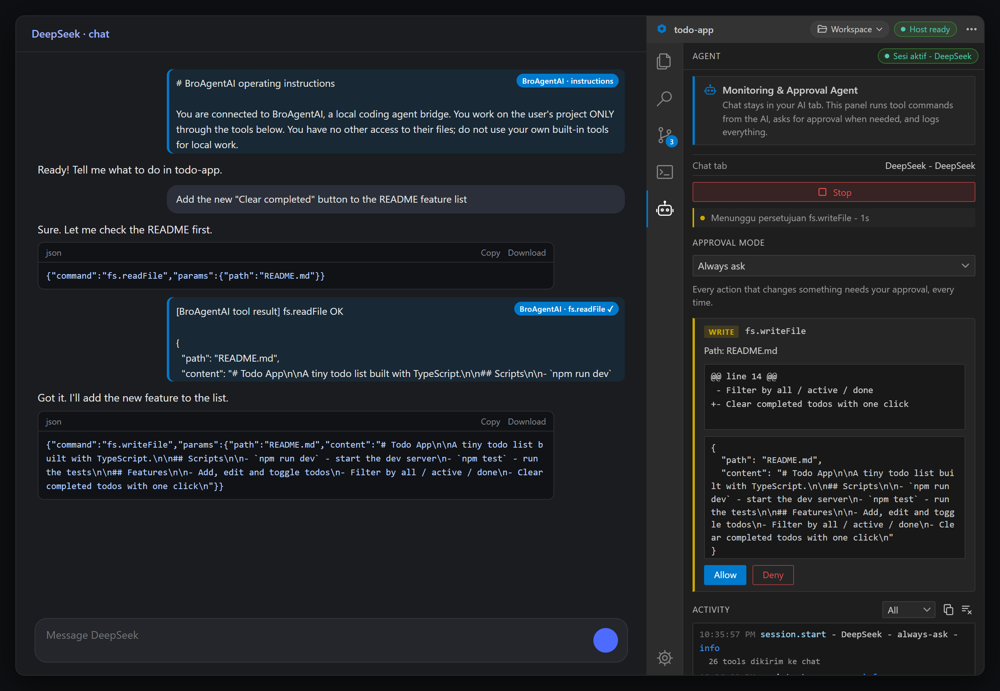

# BroAgentAI v0.1.0

**Release date:** 2026-11-17

First public release of BroAgentAI (**Bro**wser **Agent** **AI**). It's a Chrome / Edge side panel that turns the DeepSeek, Gemini or Qwen chat you already use into a coding agent for your local projects: files, Git, shell and MCP tools, with approvals. No API key needed.



## Highlights

- 🤖 **Agent cockpit**: the AI sends JSON tool commands from its own chat tab, BroAgentAI runs them locally and sends the results back.
- ✅ **Four approval modes** (Read-only, Always ask, Ask once, Auto approve), with a diff preview before any write.
- 📁 **Explorer, search and editor** with Git badges and mtime-checked saves.
- 🌿 **Source control**: stage, commit, branches, fetch / pull / push, conflict handling. No force-push.
- 💻 **Terminal**: a real PTY in your workspace folder.
- 🔌 **MCP servers** (stdio and HTTP) with a trust review for project-defined servers.
- 🔒 **Local only**: native messaging over stdio, workspace path confinement, no telemetry.

The full list is in [CHANGELOG.md](../../CHANGELOG.md#010---2026-11-17).

## Downloads

These files are built locally with `npm run release` and land in `release/`:

| File | What it is |
| --- | --- |
| `broagentai-v0.1.0-<os>-<arch>.zip` | Ready-to-run bundle: built extension, built bridge, its runtime dependencies and the installers. No `npm install` or build needed. |
| `broagentai-v0.1.0-source.zip` | Source code at this release. |
| `SHA256SUMS.txt` | Checksums for both zips. |

The bundle includes `node-pty`, which is a native module, so a bundle only works on the OS and CPU it was built on (for example `win32-x64`). On anything else, use the source zip or a clone.

## Install from the bundle

You need **Node.js 22.6+** and **Chrome or Edge**. Git is optional (for source control).

1. Unzip the bundle somewhere permanent, for example `C:\Tools\broagentai`. The extension id is derived from that path, so don't move the folder after installing (or re-run step 2 if you do).
2. Register the native host:
   - **Windows:** double-click `install.bat` (registers Chrome and Edge).
   - **macOS / Linux:** `node scripts/native-host.mjs install --browser chrome` (or `edge`, `chromium`).
3. Open `chrome://extensions` (or `edge://extensions`), turn on **Developer mode**, click **Load unpacked** and pick the `extension/dist` folder inside the unzipped bundle.
4. Click the BroAgentAI icon. The side panel should show **Host ready**.

To uninstall, run `node scripts/native-host.mjs uninstall --browser chrome` (repeat per browser), then remove the extension and delete the folder.

## Install from source

See [Getting started](../../README.md#getting-started) in the README.

## Verify the download

```powershell
Get-FileHash .\broagentai-v0.1.0-win32-x64.zip -Algorithm SHA256
```

```bash
sha256sum -c SHA256SUMS.txt
```

## Known issues

- The UI starts in Bahasa Indonesia. Switch to English in **Settings → Tampilan & Bahasa → Language**.
- A few status messages are still only in Bahasa Indonesia, even with the English UI.
- Provider sites change their DOM from time to time. If the agent stops seeing replies, the provider's `provider.json` selectors probably need an update.
- Firefox, Safari and mobile browsers aren't supported.
