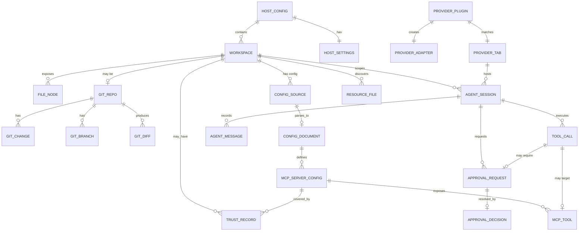

# BroAgentAI — Entity Relationship Document (ERD)

| Field | Value |
| --- | --- |
| Status | Draft v0.1 |
| Date | 2026-11-15 |
| Related | `00-PRD.md`, `01-BRD.md`, `02-TSD.md`, `03-FSD.md`, `05-ADR.md`, `06-ROADMAP.md`, `07-PLUGIN-MCP.md` |

## 1. Overview

BroAgentAI has five data domains:

1. **Host-persistent data** — workspaces, active workspace, host settings (JSON app config).
2. **Project-managed data** — JSONC config, instructions, rules, skills, agents, commands, provider metadata.
3. **MCP data** — server definitions, trust records, server status, tool descriptors.
4. **Extension-persistent data** — UI settings, last active workspace, provider preferences (`chrome.storage.local`).
5. **Session data** — companion state, agent session, tool calls, approvals, transcript (`chrome.storage.session`).

There is no database in the MVP. The ERD describes logical entities and their TypeScript shapes. Project files are the source of truth for configuration; the host only caches the merged result.

## 2. Logical ERD



## 3. Host config

### 3.1 HostConfig

```ts
interface HostConfig {
  version: 1;
  activeWorkspaceId: string | null;
  workspaces: Workspace[];
  settings: HostSettings;
}

interface Workspace {
  id: string;             // sha256(realPath).slice(0, 16)
  name: string;           // display name, default basename
  path: string;           // absolute realpath
  lastOpenedAt: string;   // ISO 8601
}

interface HostSettings {
  ignore: string[];       // default: .git, node_modules, .venv, dist, build
  maxFileBytes: number;   // default 524288
  maxSearchResults: number; // default 500
  logLevel: "error" | "warn" | "info" | "debug";
}
```

Invariants:

- `workspaces[].id` is unique.
- `workspaces[].path` is unique after realpath normalization.
- `activeWorkspaceId` is null or matches an existing workspace.
- `maxFileBytes` > 0.
- Unknown fields are preserved on read where safe, or dropped with a version migration.

### 3.2 Config file layout

```json
{
  "version": 1,
  "activeWorkspaceId": "a1b2c3d4e5f60789",
  "workspaces": [
    {
      "id": "a1b2c3d4e5f60789",
      "name": "my-project",
      "path": "D:\\work\\my-project",
      "lastOpenedAt": "2026-11-15T10:00:00.000Z"
    }
  ],
  "settings": {
    "ignore": [".git", "node_modules", ".venv", "dist", "build"],
    "maxFileBytes": 524288,
    "maxSearchResults": 500,
    "logLevel": "info"
  }
}
```

Write policy:

- Write to `config.json.tmp`, then atomic rename.
- Create the directory if missing.
- On parse failure, back up the file and start with defaults.
- Never write secrets.

## 4. Filesystem entities

### 4.1 FileNode

```ts
interface FileNode {
  name: string;
  path: string;          // workspace-relative, POSIX separators
  type: "file" | "directory" | "symlink";
  size?: number;
  mtimeMs?: number;
  gitStatus?: GitChangeKind;
  hasChildren?: boolean;
}
```

### 4.2 FileStat

```ts
interface FileStat {
  path: string;
  type: "file" | "directory" | "symlink";
  size: number;
  mtimeMs: number;
  isBinary: boolean;
  isIgnored: boolean;
}
```

### 4.3 FileContent

```ts
interface FileContent {
  path: string;
  content: string;       // UTF-8
  encoding: "utf8";
  mtimeMs: number;
  size: number;
  truncated: boolean;
}
```

### 4.4 FileEdit

```ts
interface FileEdit {
  oldText: string;
  newText: string;
}

interface ApplyPatchParams {
  path: string;
  edits: FileEdit[];     // all-or-nothing, each oldText unique
}
```

### 4.5 SearchResult

```ts
interface SearchMatch {
  path: string;
  line: number;          // 1-based
  column: number;        // 1-based
  preview: string;
}

interface SearchResponse {
  matches: SearchMatch[];
  truncated: boolean;
  nextCursor?: string;
}
```

## 5. Git entities

### 5.1 GitRepo

```ts
interface GitRepo {
  workspaceId: string;
  root: string;
  branch: string | null;
  detached: boolean;
  upstream: string | null;
  remotes: GitRemote[];
  operation: "none" | "merge" | "rebase" | "cherry-pick" | "revert";
}

interface GitRemote {
  name: string;
  fetchUrl: string;
  pushUrl: string;
}
```

### 5.2 GitStatus

```ts
type GitChangeKind =
  | "modified" | "added" | "deleted" | "renamed"
  | "copied" | "untracked" | "conflicted" | "ignored";

interface GitChange {
  path: string;
  oldPath?: string;
  index: GitChangeKind | null;     // staged
  workingTree: GitChangeKind | null;
  conflicted: boolean;
}

interface GitStatus {
  branch: string | null;
  detached: boolean;
  upstream: string | null;
  ahead: number;
  behind: number;
  changes: GitChange[];
  operation: "none" | "merge" | "rebase" | "cherry-pick" | "revert";
}
```

### 5.3 GitDiff

```ts
interface GitDiff {
  path: string;
  staged: boolean;
  binary: boolean;
  hunks: DiffHunk[];
  truncated: boolean;
  nextCursor?: string;
}

interface DiffHunk {
  oldStart: number;
  oldLines: number;
  newStart: number;
  newLines: number;
  header: string;
  lines: DiffLine[];
}

interface DiffLine {
  kind: "context" | "add" | "del";
  content: string;
  oldLine?: number;
  newLine?: number;
}
```

### 5.4 GitBranch and GitCommit

```ts
interface GitBranch {
  name: string;
  current: boolean;
  upstream?: string;
  ahead?: number;
  behind?: number;
}

interface GitCommit {
  hash: string;
  shortHash: string;
  subject: string;
  authorName: string;
  authorEmail: string;
  date: string;
}
```

## 6. Protocol entities

### 6.1 RpcRequest

```ts
interface RpcRequest<P = unknown> {
  v: 1;
  id: number;
  method: RpcMethod;
  params?: P;
}

type RpcMethod =
  | "system.ping" | "system.info" | "system.shutdown"
  | "workspace.list" | "workspace.add" | "workspace.remove"
  | "workspace.setActive" | "workspace.validate"
  | "workspace.trust" | "workspace.untrust"
  | "config.get" | "config.reload" | "config.validate"
  | "instructions.list" | "skills.list" | "skills.read"
  | "agents.list" | "agents.read" | "commands.list"
  | "tools.list"
  | "mcp.servers" | "mcp.tools" | "mcp.start" | "mcp.stop"
  | "mcp.restart" | "mcp.callTool"
  | "fs.listDir" | "fs.listTree" | "fs.stat" | "fs.readFile"
  | "fs.readFileLines" | "fs.writeFile" | "fs.createFile"
  | "fs.createDirectory" | "fs.rename" | "fs.copy" | "fs.delete"
  | "fs.search" | "fs.find" | "fs.applyPatch"
  | "git.status" | "git.diff" | "git.stage" | "git.unstage"
  | "git.discard" | "git.commit" | "git.branches" | "git.createBranch"
  | "git.switchBranch" | "git.fetch" | "git.pull" | "git.push"
  | "git.abort" | "git.remotes" | "git.testRemote"
  | "watch.start" | "watch.stop";
```

### 6.2 RpcResponse

```ts
type RpcResponse<T = unknown> =
  | { v: 1; id: number; ok: true; result: T }
  | { v: 1; id: number; ok: false; error: RpcError };

interface RpcError {
  code: RpcErrorCode;
  message: string;
  details?: Record<string, unknown>;
}

type RpcErrorCode =
  | "BAD_REQUEST" | "METHOD_NOT_FOUND" | "WORKSPACE_NOT_FOUND"
  | "WORKSPACE_NOT_ACTIVE" | "PATH_ESCAPE" | "PATH_NOT_FOUND"
  | "NOT_A_FILE" | "NOT_A_DIRECTORY" | "FILE_TOO_LARGE"
  | "BINARY_FILE" | "MTIME_CONFLICT" | "GIT_NOT_REPO"
  | "GIT_AUTH_FAILED" | "GIT_CONFLICT" | "GIT_OPERATION_FAILED"
  | "CONFIG_INVALID" | "MCP_UNTRUSTED" | "MCP_NOT_READY" | "MCP_ERROR"
  | "TIMEOUT" | "NOT_ALLOWED" | "INTERNAL";
```

### 6.3 RpcEvent

```ts
type RpcEvent =
  | { v: 1; event: "host.ready"; data: HostInfo }
  | { v: 1; event: "fs.changed"; data: { workspaceId: string; paths: string[]; kind: "create" | "update" | "delete" } }
  | { v: 1; event: "git.changed"; data: { workspaceId: string } }
  | { v: 1; event: "config.changed"; data: { workspaceId: string; mcpHash: string; diagnostics: ConfigDiagnostic[] } }
  | { v: 1; event: "mcp.status"; data: { workspaceId: string; serverId: string; state: McpServerState; error?: string } }
  | { v: 1; event: "mcp.toolsChanged"; data: { workspaceId: string; serverId: string; tools: ToolDescriptor[] } }
  | { v: 1; event: "host.error"; data: { message: string; code?: string } };

interface HostInfo {
  hostVersion: string;
  protocolVersion: 1;
  platform: "win32" | "darwin" | "linux";
  configPath: string;
  logPath: string;
}
```

## 7. Configuration, resource, MCP, and provider entities

### 7.1 ConfigSource and ConfigDocument

```ts
type ConfigScope = "global" | "project" | "local";

interface ConfigSource {
  scope: ConfigScope;
  path: string;
  exists: boolean;
  readable: boolean;
  lastModifiedMs: number | null;
  sizeBytes: number | null;
}

interface ConfigDocument {
  source: ConfigSource;
  raw: string;
  parsed: BroAgentAIConfig | null;
  hash: string;
  diagnostics: ConfigDiagnostic[];
}

interface ConfigDiagnostic {
  severity: "error" | "warning";
  message: string;
  line?: number;
  column?: number;
  path?: string;
}

interface EffectiveConfig {
  value: BroAgentAIConfig;
  sources: ConfigSource[];
  warnings: ConfigDiagnostic[];
  mcpHash: string;
  resolvedAt: string;
}
```

### 7.2 BroAgentAIConfig

```ts
interface BroAgentAIConfig {
  $schema?: string;
  version?: 1;
  agent?: AgentPreferences;
  providers?: Record<string, ProviderPreference>;
  instructions?: string[];
  rules?: string[];
  skills?: string[];
  agents?: string[];
  commands?: string[];
  mcp?: Record<string, McpServerConfig>;
}

interface AgentPreferences {
  defaultProvider?: string;
  defaultApprovalMode?: ApprovalMode;
  maxIterations?: number;
  reminderInterval?: number;
}

interface ProviderPreference {
  enabled?: boolean;
}

```

### 7.3 ResourceFile and resource definitions

```ts
type ResourceKind = "instruction" | "rule" | "skill" | "agent" | "command";

interface ResourceFile {
  kind: ResourceKind;
  path: string;
  scope: ConfigScope;
  sizeBytes: number;
  hash: string;
  frontmatter: Record<string, unknown>;
}

interface SkillDefinition {
  name: string;
  description: string;
  path: string;
  scope: ConfigScope;
}

interface AgentDefinition {
  name: string;
  description: string;
  path: string;
  mode?: ApprovalMode;
  provider?: string;
}

interface AgentProfile extends AgentDefinition {
  body: string;
  truncated?: boolean;
}

interface RuleDefinition {
  name: string;
  path: string;
  scope: ConfigScope;
}

interface CommandDefinition {
  name: string;
  description: string;
  path: string;
  agent?: string;
  body: string; // complete template, max 16 KB
}
```

Invariants:

- Resource paths resolve under the workspace root or global config root.
- Skill names match `[a-z0-9-]+` and are unique by scope precedence.
- Metadata is available without reading bodies into prompts.
- Invalid frontmatter produces a warning and default metadata where possible.
- An agent profile's `mode` may only narrow the current approval mode; it never grants broader permissions.

### 7.4 MCP entities

```ts
type McpTransport = "stdio" | "http" | "sse";

type McpServerConfig = McpLocalServerConfig | McpRemoteServerConfig;

interface McpLocalServerConfig {
  type: "local";
  command: string[];
  environment?: Record<string, string>;
  cwd?: string;
  enabled?: boolean;
  autoStart?: boolean;
  timeoutMs?: number;
  risk?: RiskClass;
  toolRisk?: Record<string, RiskClass>;
}

interface McpRemoteServerConfig {
  type: "remote";
  url: string;
  headers?: Record<string, string>;
  enabled?: boolean;
  autoStart?: boolean;
  timeoutMs?: number;
  risk?: RiskClass;
  toolRisk?: Record<string, RiskClass>;
}

type McpServerState =
  | "untrusted" | "disabled" | "stopped" | "starting"
  | "ready" | "stopping" | "error";

interface McpServerStatus {
  id: string;
  origin: ConfigScope; // highest layer defining security-relevant fields (command/URL/cwd/env/header/risk)
  transport: McpTransport;
  state: McpServerState;
  trusted: boolean;
  toolCount: number;
  error?: string;
  startedAt?: string;
}

interface McpTool {
  serverId: string;
  name: string;
  namespacedName: string; // mcp.<serverId>.<name>
  description: string;
  inputSchema: Record<string, unknown>;
  risk: RiskClass;
  annotations?: {
    readOnlyHint?: boolean;
    destructiveHint?: boolean;
    idempotentHint?: boolean;
    openWorldHint?: boolean;
  };
}

interface TrustRecord {
  workspacePath: string;
  mcpHash: string;
  trustedAt: string;
}
```

Rules:

- `command` must be a non-empty string array; no shell.
- `autoStart` is honored only for global config; project-defined servers always require an explicit start action after trust.
- `trusted` is false when no trust record matches realpath + `mcpHash`.
- Global/local definitions are trusted; a project-layer override does not inherit that trust and sets `origin` to `project`.
- `mcpHash` covers server commands, URLs, working directories, environment/header keys, and risk overrides, but not secret values.
- Tool risk base: `destructiveHint` → `destructive`, else `readOnlyHint` → `read`, else `write`.
- Config risk overrides may only escalate the base risk; they can never downgrade it. Project config cannot mark a destructive tool as read.
- Status is per server; one error does not change other servers.

### 7.5 Provider plugin entities

```ts
interface ProviderMetadata {
  id: string;
  label: string;
  description?: string;
  homepage?: string;
  matchPatterns: string[];
  capabilities: ProviderCapabilities;
  status: "planned" | "ready";
}

interface ProviderCapabilities {
  streaming: "dom" | "sse" | "none";
  attachments: boolean;
  reasoning: boolean;
  codeBlocks: boolean;
}

interface ProviderPlugin {
  metadata: ProviderMetadata;
  createAdapter(): ProviderAdapter;
}

interface ProviderHealth {
  providerId: string;
  tabId?: number;
  status: "no-tab" | "ready" | "logged-out" | "generating" | "adapter-error";
  detail?: string;
  checkedAt: string;
}
```

Rules:

- `matchPatterns` come from bundled provider metadata; runtime `providers` config can only toggle `enabled`.
- Config cannot add host permissions or content scripts.
- Provider adapter code is bundled with the extension; no runtime remote code.

### 7.6 ToolDescriptor

The agent loop uses one descriptor shape for built-in and MCP tools:

```ts
interface ToolDescriptor {
  name: string;
  source: "builtin" | "mcp";
  description: string;
  inputSchema: Record<string, unknown>;
  risk: RiskClass;
  mcp?: { serverId: string; toolName: string };
}
```

## 8. Agent entities

### 8.1 AgentSession

```ts
interface AgentSession {
  id: string;               // uuid
  workspaceId: string;
  providerId: string;
  agentProfile?: string;
  approvalMode: ApprovalMode;
  startedAt: string;
  endedAt?: string;
  status: "idle" | "starting" | "ready" | "generating" | "waiting-approval" | "paused" | "error" | "ended";
  iterationCount: number;
  maxIterations: number;
}

type ProviderId = "deepseek" | "gemini" | "qwen" | "chatgpt" | "claude" | "grok" | "kimi" | "glm" | "meta" | "mistral" | "ptero" | "arena";

type ApprovalMode = "read-only" | "ask" | "auto-edit" | "full-auto";
```

### 8.2 AgentMessage

```ts
interface AgentMessage {
  id: string;
  sessionId: string;
  role: "user" | "assistant" | "system" | "tool";
  content: string;
  createdAt: string;
  streaming?: boolean;
  toolCallId?: string;
}
```

### 8.3 ToolCall

```ts
type RiskClass = "read" | "write" | "destructive" | "git" | "sync";

interface ToolCall {
  id: string;
  sessionId: string;
  method: RpcMethod;
  source: "builtin" | "mcp";
  mcp?: { serverId: string; toolName: string };
  params: Record<string, unknown>;
  risk: RiskClass;
  status: "pending-approval" | "running" | "success" | "error" | "denied" | "cancelled";
  startedAt: string;
  endedAt?: string;
  durationMs?: number;
  error?: RpcError;
  resultSummary?: string;
  truncated?: boolean;
}
```

Risk mapping:

| Risk | Methods |
| --- | --- |
| read | `system.ping`, `system.info`, `config.get`, `config.reload`, `config.validate`, `instructions.list`, `skills.list`, `skills.read`, `agents.list`, `agents.read`, `commands.list`, `tools.list`, `mcp.servers`, `mcp.tools`, `workspace.validate`, `fs.listDir`, `fs.stat`, `fs.readFile`, `fs.readFileLines`, `fs.search`, `fs.find`, `git.status`, `git.diff`, `git.branches`, `git.remotes` |
| write | `workspace.add`, `workspace.remove`, `workspace.setActive`, `fs.writeFile`, `fs.createFile`, `fs.createDirectory`, `fs.rename`, `fs.copy`, `fs.applyPatch`, `git.stage`, `git.unstage`, `git.commit`, `git.createBranch`, `git.switchBranch`, `mcp.callTool` (default; adjusted by annotations) |
| destructive | `system.shutdown`, `workspace.trust`, `workspace.untrust`, `mcp.start`, `mcp.stop`, `mcp.restart`, `fs.delete`, `git.discard`, `git.abort` |
| git | `git.stage`, `git.unstage`, `git.commit`, `git.createBranch`, `git.switchBranch` |
| sync | `git.fetch`, `git.pull`, `git.push`, `git.testRemote` |

### 8.4 Approval

```ts
interface ApprovalRequest {
  id: string;
  sessionId: string;
  toolCallId: string;
  risk: RiskClass;
  summary: string;
  details: Record<string, unknown>;
  diffPreview?: string;
  createdAt: string;
  expiresAt?: string;
}

interface ApprovalDecision {
  requestId: string;
  decision: "allow-once" | "allow-session" | "deny";
  scope?: {
    method: RpcMethod;
    pathPrefix?: string;
    mcpServerId?: string;
    mcpToolName?: string;
  };
  decidedAt: string;
}
```

### 8.5 Provider binding

`ProviderMetadata` and `ProviderHealth` are defined in section 7.5. A session stores the resolved provider ID and the tab it is bound to.

```ts
interface ProviderBinding {
  providerId: string;
  pluginVersion: string;
  tabId?: number;
  enabled: boolean;
  preferExistingTab: boolean;
}
```

## 9. Extension storage

### 9.1 `chrome.storage.local`

```ts
interface LocalSettings {
  version: 1;
  activeWorkspaceId: string | null;
  recentWorkspaceIds: string[];
  ui: {
    theme: "system" | "light" | "dark";
    explorerShowIgnored: boolean;
    editorFontSize: number;
    editorTabSize: number;
  };
  agent: {
    defaultProvider: string;
    defaultApprovalMode: ApprovalMode;
    maxIterations: number;
    reminderInterval: number;
  };
  providers: Record<string, ProviderPreference>;
  trustedWorkspaces: Record<string, string>;
}
```

### 9.2 `chrome.storage.session`

```ts
interface SessionState {
  hostStatus: "unknown" | "connecting" | "ready" | "offline" | "outdated" | "error";
  hostInfo?: HostInfo;
  activeSession?: AgentSession;
  messages: AgentMessage[];       // capped, e.g. last 500
  toolCalls: ToolCall[];          // capped, e.g. last 500
  pendingApprovals: ApprovalRequest[];
  commandLog: ToolCall[];         // capped, e.g. last 1,000
  openEditorTabs: { workspaceId: string; path: string }[];
  effectiveConfig?: EffectiveConfig;
  resources?: ResourceFile[];
  skills?: SkillDefinition[];
  agents?: AgentDefinition[];
  commands?: CommandDefinition[];
  mcpServers: McpServerStatus[];
  mcpTools: McpTool[];
}
```

## 10. State transitions

### 10.1 Companion

```text
unknown → connecting → ready
                    ↘ offline
                    ↘ outdated
                    ↘ error
ready → connecting (restart)
offline/error → connecting (retry)
```

### 10.2 Agent session

```text
idle → starting → ready → generating → waiting-approval → generating
                              │                │
                              ├→ paused ←──────┘
                              ├→ error
                              └→ ended
```

Rules:

- `waiting-approval` only from a tool call that requires approval.
- `paused` requires a recovery action (retry, reopen tab, continue).
- `ended` is terminal; a new session starts fresh.
- Closing the panel does not end the session; it may pause before the next approval.

### 10.3 Tool call

```text
pending-approval → running → success | error
pending-approval → denied
pending-approval → cancelled
running → cancelled (if supported)
```

### 10.4 Git operation

```text
none → fetch (transient) → none
none → pull → none | conflict
none → rebase → none | conflict
conflict → abort → none
conflict → resolved+commit → none
```

### 10.5 MCP server

```text
untrusted → untrusted (config changed)
untrusted → stopped (trust granted, not started)
stopped → starting → ready → stopping → stopped
starting → error → starting (restart)
ready → error → starting (restart)
any → stopped (host shutdown)
any → untrusted (trust revoked or project config changed; servers stop)
```

Rules:

- Project servers start in `untrusted` until a trust record matches realpath + `mcpHash`.
- `autoStart` is honored only for global config; project-defined servers always require an explicit start action after trust.
- A config change that alters commands/URLs/cwd/env/header/risk fields immediately invalidates trust, stops any running project server, and moves it to `untrusted`.
- Stop kills the child/remote session; restart is stop → start with a new client.
- A server error does not affect other servers.

### 10.6 Configuration

```text
none → parsed → merged → applied
parsed → invalid (diagnostics)
invalid → previous-effective (session continues) | blocked (safety-critical)
applied → stale (file changed) → parsed
```

Rules:

- Config is read on workspace activation and on `config.reload`.
- Invalid config never replaces the last known good config for a running session.
- Safety-critical invalid fields (e.g., malformed `mcp` values) block new MCP starts, not file/Git tools.
- A running agent turn is not mutated; changes apply on the next turn or session restart.

## 11. IDs and timestamps

- Workspace ID: `sha256(realPath).slice(0, 16)` (hex).
- Session/message/tool-call/approval IDs: UUID v4.
- RPC IDs: monotonically increasing integer per port, reset on reconnect.
- Timestamps: ISO 8601 UTC strings at API boundaries; `mtimeMs` numeric for file comparisons.
- Paths at API boundaries: workspace-relative with `/` separators; host accepts native separators and normalizes.

## 12. Retention and limits

| Data | Limit |
| --- | --- |
| Workspaces | 50 |
| Session messages | 500 per session (oldest dropped) |
| Tool calls | 500 per session, 1,000 in command log |
| Pending approvals | 20 (queue, one actionable) |
| File tree nodes per response | 2,000 |
| Search matches | 500 |
| Git changes | 2,000 |
| Diff size | 512 KB per file |
| Config file size | 512 KB per source |
| Resource files | 200, depth 4 |
| Instruction prompt budget | 64 KB |
| Skills/agents/commands returned | 200 each |
| Command template body | 16 KB |
| MCP servers | 16 |
| MCP tools per server | 256 |
| MCP result | 512 KB |
| MCP server log buffer | 64 KB |
| Trust records | 200 |
| Log file | 5 MB × 3 rotations |

## 13. Migration

- `HostConfig.version`, `BroAgentAIConfig.version`, and `LocalSettings.version` are integers.
- On read, if version is older, run migrations in order and write back.
- Unknown future versions → read-only mode with a warning, do not overwrite.
- Trust records store `mcpHash`; changing the hash invalidates trust instead of migrating it.
- Resource/frontmatter shapes are additive; unknown keys are preserved in metadata but ignored.
- MVP only has version 1; migration scaffolding is still required.


